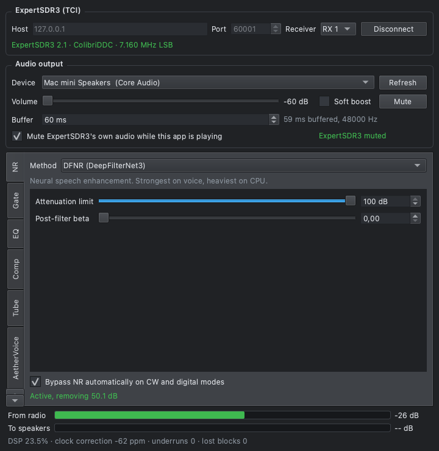

# ExpertSDR3 Audio

Plays ExpertSDR3's receive audio through the
[AetherSDR](https://github.com/aethersdr/AetherSDR) **AetherRX** chain, so you can use its
noise reduction with any radio ExpertSDR3 supports.

```
ExpertSDR3 ──TCI──▶ NR (one method) ──▶ Gate ▶ EQ ▶ Comp ▶ Tube ▶ AetherVoice ──▶ your sound device
```

It connects over [TCI](https://github.com/ExpertSDR3/TCI), lets you pick any audio output
on the machine, and mutes ExpertSDR3's own audio while it plays so you don't hear both.



## Noise reduction methods

Pick one from the **AetherNR** page's tabs or with `--nr`. All are AetherSDR's own code, unmodified.

| Method | What it is | SNR gain | Noise in pauses | Delay | CPU |
|---|---|---|---|---|---|
| `dfnr` DeepFilterNet3 | Neural | +10 dB | -32 dB | 41 ms | 28% |
| `rn2` RNNoise | Neural | +5 dB | -36 dB | 31 ms | 27% |
| `nnr` WDSP NNR | Neural | +5 dB | -29 dB | 51 ms | 29% |
| `nr4` libspecbleach | Spectral | +5 dB | -6 dB (at the 10 dB default) | 40 ms | 20% |
| `mnr` Apple vDSP | Spectral, macOS only | +5 dB | -24 dB | 21 ms | 1% |
| `nr2` WDSP-derived | Spectral | +2 dB | -19 dB | 43 ms | 2-7% |

SNR, pause noise and delay are from `test_rx_chain`: synthetic speech at +6 dB SNR in white
noise, at 48 kHz with default settings. They show the methods work and roughly how they
differ, but are not a listening test, and real band noise behaves differently. CPU is the
share of one Apple Silicon core, in stereo, on a live stream. Delay excludes the output
buffer (60 ms by default).

DFNR is not offered when macOS runs in a virtual machine: its library always uses an Apple
Silicon coprocessor that VMs do not expose, so it would crash.

NR is bypassed automatically on CW and digital modes, because those signals are not speech
and a speech model treats a steady carrier as noise. You can turn this off.

## Install

Download the latest build from [Releases](https://github.com/VU3ESV/ExpertSDR3-Audio/releases):

| Platform | File | Install |
|---|---|---|
| macOS 13+ (Apple Silicon) | `-macos-arm64.dmg` | Drag to Applications. Signed and notarized. |
| Windows 10+ (x64) | `-windows-x64-setup.exe` or `-portable.zip` | Not code-signed yet, so SmartScreen warns on first run: choose **More info**, then **Run anyway**. |
| Raspberry Pi (64-bit OS) | `-raspberrypi-arm64.deb` | `sudo apt install ./<file>.deb` |
| Debian or Ubuntu (x86-64) | `-linux-x86_64.deb` | `sudo apt install ./<file>.deb` |
| Other Linux (x86-64) | `-linux-x86_64.AppImage` | `chmod +x`, then run. Needs a desktop Linux with glibc 2.36 or newer. |

32-bit Raspberry Pi OS is not supported. [docs/RELEASING.md](docs/RELEASING.md) covers how
releases are made, signed and verified.

## Build

You need CMake 3.25+, a C++20 compiler, Qt 6.4+ with WebSockets, FFTW3 and PortAudio.

**macOS**
```sh
brew install qt fftw portaudio ninja pkg-config
(cd vendor/aethersdr && bash scripts/setup/setup-deepfilter.sh)
cmake -S . -B build -G Ninja && cmake --build build
open build/ExpertSDR3Audio.app
```

**Linux and Raspberry Pi OS (64-bit)**
```sh
sudo apt install build-essential cmake ninja-build pkg-config qt6-base-dev \
  libqt6websockets6-dev libfftw3-dev portaudio19-dev libgl1-mesa-dev
(cd vendor/aethersdr && bash scripts/setup/setup-deepfilter.sh)
cmake -S . -B build -G Ninja && cmake --build build
./build/ExpertSDR3Audio
```

**Windows** (Visual Studio with the clang-cl component, and Qt 6 from the Qt installer)
```powershell
vcpkg install fftw3:x64-windows
cd vendor\aethersdr; .\scripts\setup\setup-deepfilter.ps1; cd ..\..
cmake -S . -B build -T ClangCL -DCMAKE_TOOLCHAIN_FILE=<vcpkg>\scripts\buildsystems\vcpkg.cmake
cmake --build build --config Release --parallel
```
PortAudio is built from source automatically on Windows.

The DeepFilterNet step downloads a checksum-verified prebuilt library, or builds it with
Cargo if there is none for your platform. Skip it to build without DFNR. Other options:
`-DENABLE_NNR=OFF`, `-DENABLE_NR4=OFF`, `-DBUILD_TESTS=OFF`.

## Use

1. In ExpertSDR3, enable TCI in its options, and start the radio.
2. Start the app and press **Connect**. If nothing answers on the port shown, the usual TCI
   ports (40001, 50001, 60001) are tried automatically.
3. Choose your **Device** on **Final Output**, and a method from the **AetherNR** page's tabs.

To run without a display, for example on a Raspberry Pi:
```sh
ExpertSDR3Audio --list-devices
ExpertSDR3Audio --headless --host 192.168.1.20 --port 40001 --device "USB" --nr nr2
ExpertSDR3Audio --list-params   # everything --set can change
```

## Finding radios

**Find Radios...** looks for computers on your network running ExpertSDR3 with TCI enabled, and
connects to the one you pick. `ExpertSDR3Audio --discover` does the same from a terminal.

TCI has no way to announce itself, so this tries the usual TCI ports (40001, 50001, 60001, plus
whatever is in the Port box) on each address, which takes about 10 seconds. It only reads each
server's greeting and sends no commands, so it cannot disturb a radio in use. It stays on private
addresses, skips VPN links, and checks only the 254 addresses around this computer on each network
adapter. For anything further away, type the host and port in the main window.

On a Mac, the first scan asks for permission to use the local network. If you allow it, scan again.

## Profiles

A profile saves everything in the tabs: the noise reduction method and its settings, every stage,
and the stage order. It leaves out the radio, output device, volume and buffer, so it can move to
another computer without bringing that computer's hardware along.

Pick one from the **Profile** list, or **Factory settings** to start over. **Modified** means the
sound has changed since it was saved. **Export...** writes a `.json` file to share or back up, and
**Export All...** in the Profiles menu writes every profile to one file. **Import...** reads either
kind, renames anything whose name is taken rather than replacing it, and leaves the current sound
alone until you choose one.

A profile that uses a method this computer lacks, such as MNR away from a Mac, plays with NR off,
and keeps the setting in case it travels back.

From a terminal:
```sh
ExpertSDR3Audio --list-profiles
ExpertSDR3Audio --import-profile shared.json
ExpertSDR3Audio --export-profile "Weak SSB" > weak-ssb.json
ExpertSDR3Audio --headless --device "USB" --profile "Weak SSB"
```

## How muting works

With **Mute ExpertSDR3's own audio** on (the default), the app sends `MUTE` only once audio
is really playing, and undoes it when you disconnect or quit.

- A radio you had already muted stays muted afterwards.
- Unmuting in ExpertSDR3 wins, and the app won't fight you. Moving ExpertSDR3's volume
  control counts too, because that also unmutes it.
- If the output device fails or the stream stops, ExpertSDR3 is unmuted at once, so you
  are never left with silence from both.
- If the app crashes, ExpertSDR3 stays muted until the next time the app connects, which
  then restores it. If you never run it again, unmute in ExpertSDR3.

[docs/TCI-NOTES.md](docs/TCI-NOTES.md) has the protocol behaviour behind this.

## Platform status

| Platform | Status |
|---|---|
| macOS (Apple Silicon) | Tested live against ExpertSDR3 2.1 on a ColibriDDC, including the Developer ID signed build from its DMG. Built and tested in CI |
| Windows | Built, tested and run from both the installer and the zip in CI. **Not yet tried on a real PC, with a radio or sound device** |
| Linux x86-64 | Built, tested, and run from the `.deb` and AppImage on Debian 12 and 13 and Ubuntu 24.04 and 26.04 in CI. **Not yet tried with a radio or sound device** |
| Raspberry Pi (64-bit) | The same, on arm64. **Not yet tried on a real Pi** |

**Raspberry Pi.** Install the `.deb`, which also suits a headless Pi OS Lite; the AppImage needs
the desktop version's libraries. Start with `nr2`. The neural methods need about 28% of an Apple Silicon
core here, and a Pi core is several times slower, so they may not keep up; the app warns if
so. Note that `--rate 24000` adds about 150 ms of delay from resampling and does not make
RN2 any cheaper, because RNNoise always runs at 48 kHz internally.

**Transceivers.** Testing so far is on a receive-only radio. While transmitting, the chain
is bypassed and restarts cleanly afterwards, but that has only been tested against a
simulated server.

## Adding a noise reduction method

Each method is an adapter plus one table entry, both in
[src/dsp/NrRegistry.cpp](src/dsp/NrRegistry.cpp):

```cpp
class MyProcessor final : public NrProcessor { /* process, reset, setParam */ };

methods.append({QStringLiteral("my"), QStringLiteral("My Method"), QStringLiteral("What it does."),
    {{QStringLiteral("my.amount"), QStringLiteral("Amount"), 0.0, 1.0, 0.5, 2}},
    [](int rate) { return makeIfValid<MyProcessor>(rate); }});
```

The GUI controls, saved settings, `--nr`, `--set` and the test suite all pick it up from
that entry, and `test_rx_chain` will hold it to the same bar as the others.

## Updating the AetherRX code

`vendor/aethersdr` is an unmodified subset of AetherSDR, at the commit in
`vendor/aethersdr/UPSTREAM_COMMIT`. To take upstream DSP improvements:

```sh
scripts/sync-aether.sh /path/to/AetherSDR
(cd vendor/aethersdr && bash scripts/setup/setup-deepfilter.sh)
cmake --build build && ctest --test-dir build
```

## Tests

```sh
QT_QPA_PLATFORM=offscreen ctest --test-dir build --output-on-failure
```

These need no radio or sound device. `test_engine_e2e` runs the real engine against a
simulated server built from measurements of the real one. Its settings tests skip the
native store (a Mac's preferences, the Windows registry), which belongs to your user
account, unless `ESA_TEST_NATIVE_SETTINGS=1` is set, as CI sets it.

## License

GPL-3.0, inherited from AetherSDR. See [LICENSE](LICENSE), and
[vendor/aethersdr/THIRD_PARTY_LICENSES](vendor/aethersdr/THIRD_PARTY_LICENSES) for the
bundled components. If you distribute binaries, you must also offer the source.

The window's look and its widgets are AetherSDR's own GUI code, also GPL-3.0, and it is
drawn in the Inter typeface, which is built into the app under the SIL Open Font License 1.1
([vendor/aethersdr/third_party/inter/LICENSE.txt](vendor/aethersdr/third_party/inter/LICENSE.txt)).
Every package carries that licence: `Inter-OFL.txt` beside the program on Windows and in
`/usr/share/doc/expertsdr3-audio` on Linux, and `Contents/Resources/Inter/LICENSE.txt` in
the macOS app.
